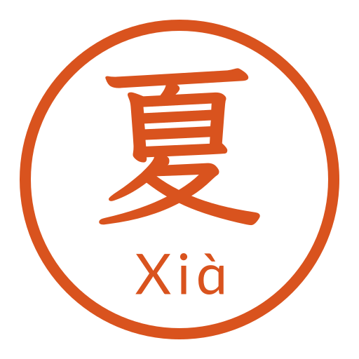
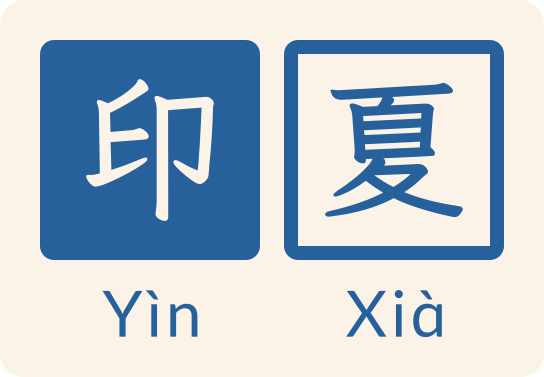

# 夏 Xià · Logo 设计仓库

<!-- 由 ./logo index 自动生成，请勿手改；标题、简介、显示名与声明见 repository.toml 的 [readme] -->

夏 Xià 系列品牌的 Logo 设计、版本与发布记录，由 [印夏 Yìn Xià](https://github.com/XiaTian-X/YinXia) 管理。

## 品牌

### 夏 Xià

- 角色：夏 Xià 系列的母品牌
- 当前发布：[r2](xia/releases/r2/release.md) · [使用指南](xia/releases/r2/guide.md)
- 固定地址（始终指向当前发布）：[`xia/latest/`](xia/latest/)

### 印夏 Yìn Xià

- 角色：夏 Xià 系列的子品牌
- 当前发布：[r1](yinxia/releases/r1/release.md) · [使用指南](yinxia/releases/r1/guide.md)
- 固定地址（始终指向当前发布）：[`yinxia/latest/`](yinxia/latest/)

### 同夏 Tóng Xià

尚未发布。

## 系列

- [夏 Xià](_series/xia/series.md) · 背书型：母品牌 夏 Xià、子品牌 同夏 Tóng Xià、子品牌 印夏 Yìn Xià

## 标志所用字体

- [LXGW WenKai Medium](https://github.com/lxgw/LxgwWenKai) · [OFL-1.1](https://openfontlicense.org)
- [Lxgw Pinyin Regular](https://github.com/lxgw/LxgwPinyinFont) · [OFL-1.1](https://openfontlicense.org)

## 使用声明

本仓库中的标志、字标及相关设计文件均为夏（[XiaTian-X](https://github.com/XiaTian-X)）的个人品牌资产，保留所有权利。

- 仅供查看与参考；未经许可，不得商用、修改、再分发，或用作其他产品、服务、组织的标识。
- 介绍、链接或引用本品牌及其项目时，可原样展示标志；不得修改，也不得暗示赞助、合作或认可关系。
- 正式许可证正在制定中，发布前以本声明为准。如需其他用途，请在本仓库[提交 Issue](https://github.com/XiaTian-X/xia-logo/issues) 联系。
- 标志所用字体（霞鹜文楷、LxgwPinyin）依 [SIL Open Font License 1.1](https://openfontlicense.org) 授权；字体的授权不延伸到标志本身。

---

项目进度见 [PROJECTS.md](PROJECTS.md)。
